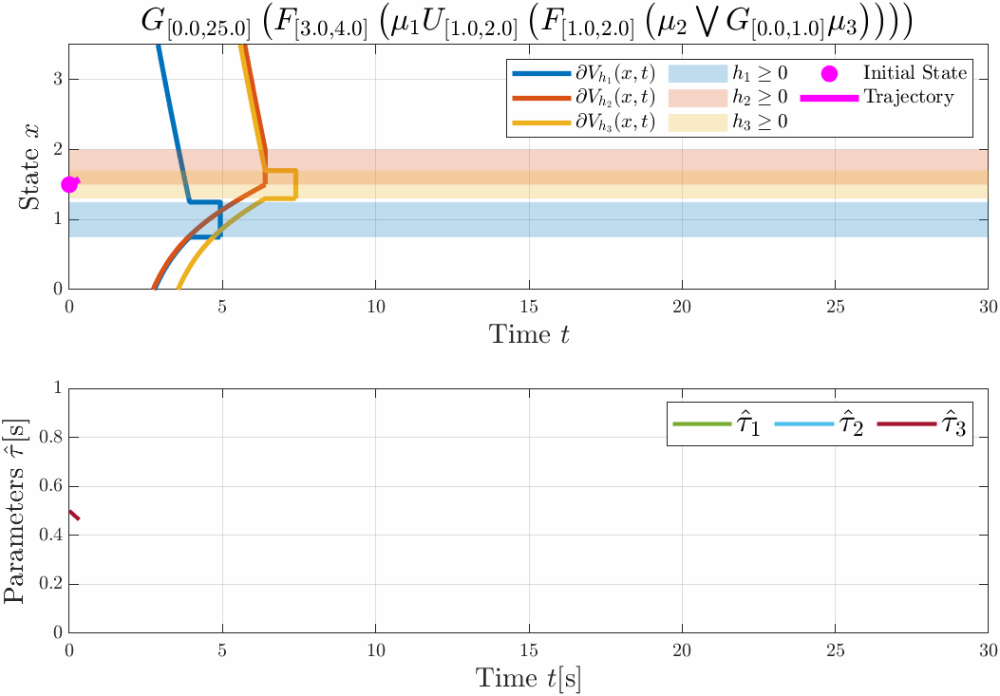
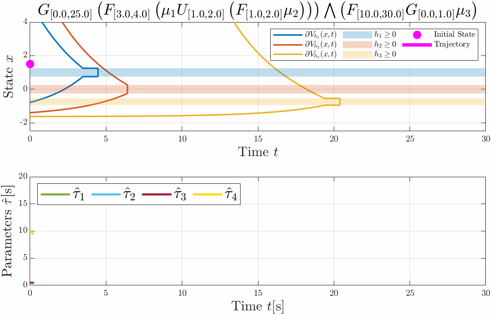
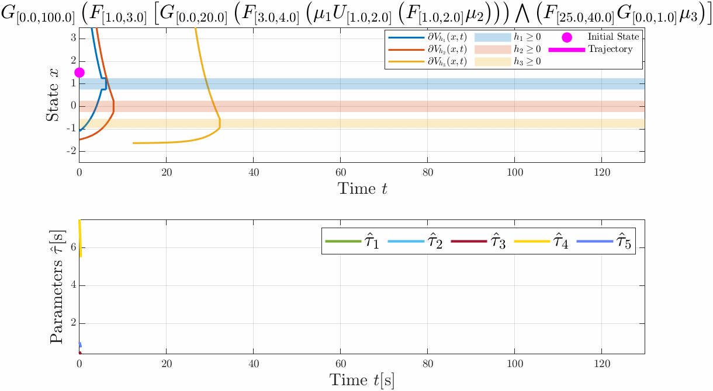

# Operator-Based-STL
---
## Code for paper "An Operator-Based Approach to Signal Temporal Logics"
This repository contains the code for reproducing the results found in the paper "An Operator-Based Approach to Signal Temporal Logics". The method concentrates on a novel approach for control and verification of complex nested STL formulae for dynamical systems based on reachability analysis. 

### Repeated Nested Formula for Non-Affine System 

### Repeated Nested Formula for Non-Affine System with Nested Disjunction
- Reference Input Positive 

- Reference Input Negative 

- Oscillating Reference Input 

### Repeated Nested Formula for Affine System 
- Simply Repeated Formula 

- Simply Repeated Formula with Conjunction

- Doubly Repeated Formula

## Running the Code
Running the files starting with "run_(...).m" in each subfolder reproduces the respective figures. 
