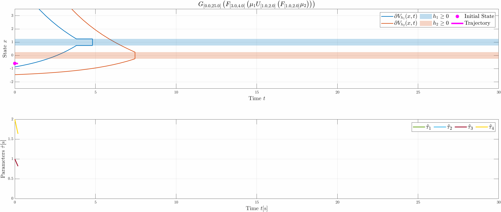

# Operator-Based-STL
Code for paper "An Operator-Based Approach to Signal Temporal Logics"
---

### Repeated Nested Formula for Affine System 


*(You can store images and GIFs in an `assets/` folder inside your repository.)*

---

## 🚀 Features

- Clear and concise bullet points describing your main features  
- Example: *Real-time rendering with GPU acceleration*  
- Example: *Modular architecture for batch video processing*  

---

## 🧭 Getting Started

Briefly explain how users can set up or run your project:

1. Clone this repository  
   ```bash
   git clone https://github.com/yourusername/your-repo-name.git
