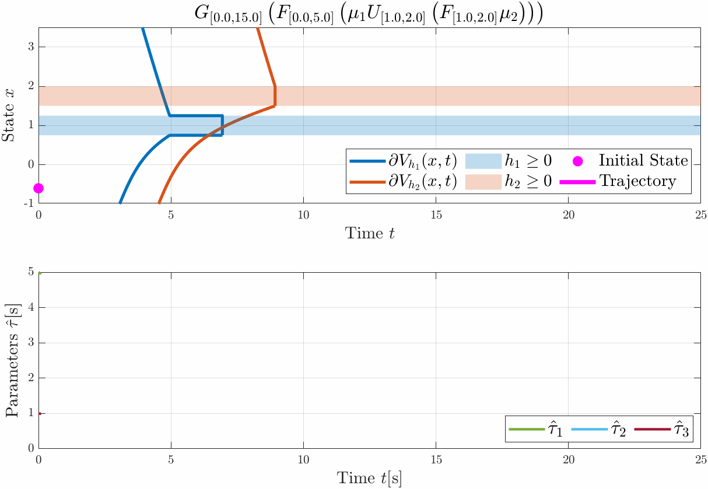
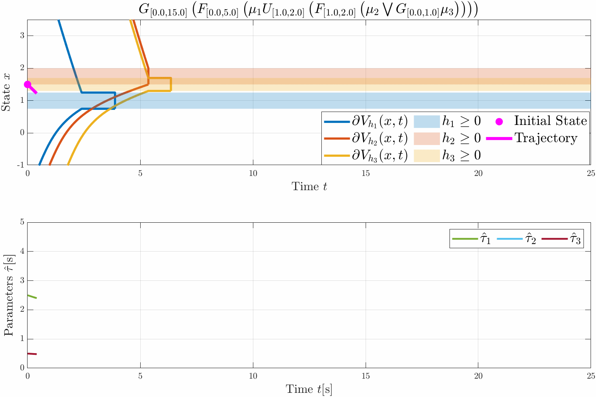
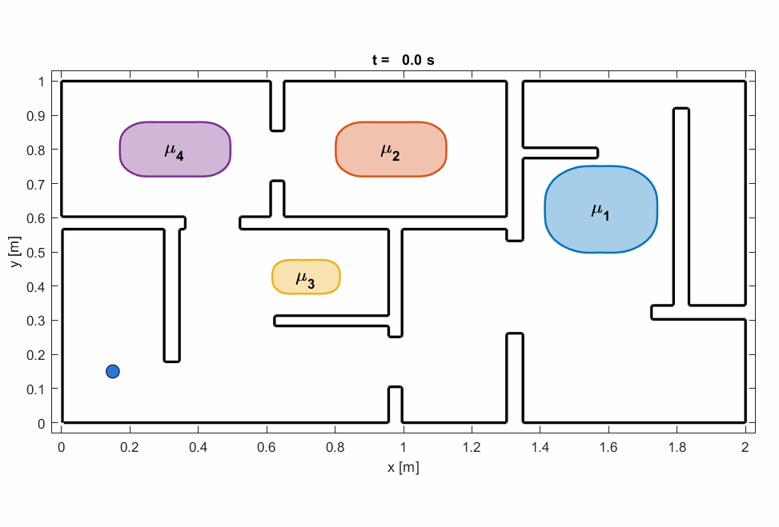
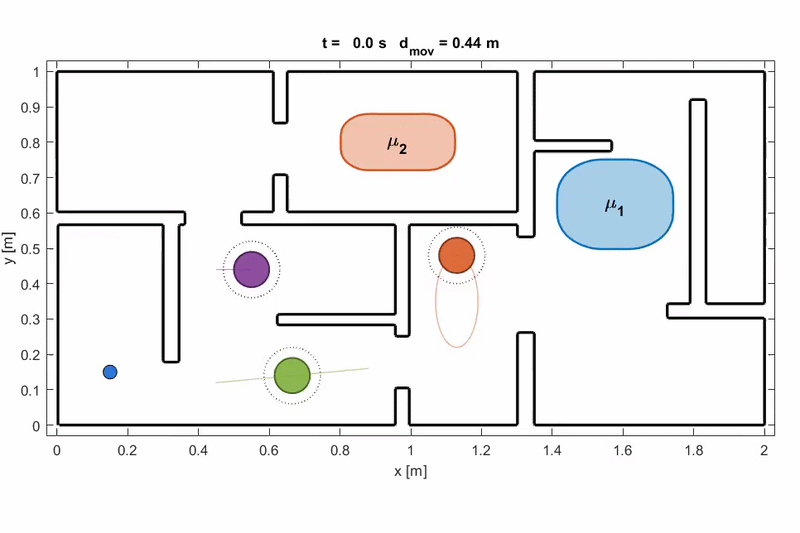
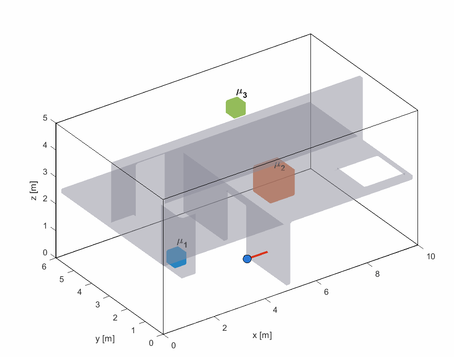

# Operator-Based-STL
---
## Supplementary material for paper "An Operator-Based Approach to Signal Temporal Logics"
This repository contains supplementary material for the paper "An Operator-Based Approach to Signal Temporal Logics". The method concentrates on a novel approach for control and verification of complex nested STL formulae for dynamical systems based on reachability analysis. 

---

### Repeated Nested Formula for Non-Affine System 

### Nested Disjunction for Non-Affine System 

### Single Integrator in Static Workspace 

### Single Integrator in Dynamic Workspace 

### Double Integrator with Yaw in Static 3D Workspace 

