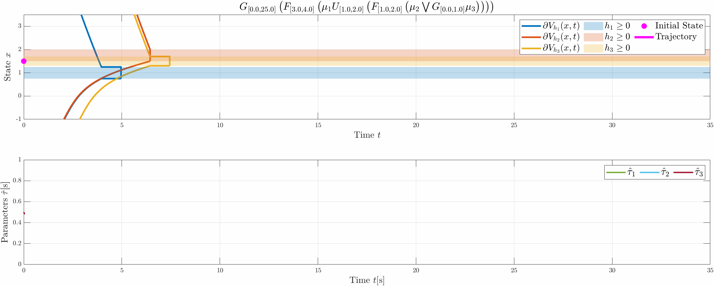

# Operator-Based-STL
Code for paper "An Operator-Based Approach to Signal Temporal Logics"
---

### Repeated Nested Formula for Affine System 
- Simply Repeated Formula 

- Simply Repeated Formula with Conjunction

- 

### Repeated Nested Formula for Non-Affine System 

### Repeated Nested Formula for Non-Affine System with Nested Disjunction
- Reference Input Positive 

- Reference Input Negative 

- Oscillating Reference Input 

---

## Briefly

---

## Running the Code

